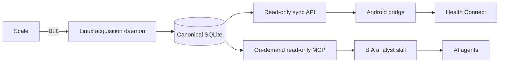

# Project map

Tracky is a local-first system for the `TS-CS10B` / `TR-CS10B` scale.

## Data flow

Linux is the sole BLE and wire-protocol owner. MCP and Android are projections over Linux-owned observations.

## Layout

| Path | Role |
| --- | --- |
| `linux/src/tracky_mcp/ble/` | BlueZ transport and device matching |
| `linux/src/tracky_mcp/protocol/` | Transport-free frame decoding and handshake state |
| `linux/src/tracky_mcp/acquisition/` | Acquisition lifecycle and persistence coordination |
| `linux/src/tracky_mcp/storage/` | Canonical SQLite records and evidence |
| `linux/src/tracky_mcp/daemon.py` | Always-on acquisition process |
| `linux/src/tracky_mcp/sync_server.py` | Authenticated, read-only Android observation endpoint |
| `linux/src/tracky_mcp/mcp/` | Agent-facing on-demand, read-only MCP adapter |
| `linux/fixtures/` | Sanitized protocol evidence and decoder goldens |
| `android/` | Non-launcher Health Connect projection, secure sync, WorkManager, and minimal import ledger |
| `skills/bia-analyst/` | Read-only agent workflow over MCP evidence |
| `contracts/` | Cross-component schemas, identity, cursor, and idempotency rules |
| `context/PROTOCOL.md` | Evidence grades and protocol knowledge |
| `context/DERIVATION.md` | Established BIA inputs, rejected coefficients, and derivation gate |
| `context/DEPLOYMENT.md` | Target runtime topology and deployment gates |
| `.pi/todos/` | Live implementation state and acceptance criteria |

## Ownership boundaries

### Linux

Own BLE discovery, GATT, handshake writes, frame capture, wire decoding, measurement quality, session lifecycle, stable source identifiers, and canonical persistence.

### MCP and skill

Read Linux history on demand. Present evidence and supported interpretations to agents. They do not scan, connect, acquire, recover daemon operations, or mutate canonical records.

### Android

Synchronize Linux-owned observations, read the latest applicable height from Health Connect
without writing height, and idempotently project supported records. Weight projection is
implemented. Derived-metric projection and any additional profile inputs remain gated on recovering
the exact QN scale-family formulas for the established 20/100 kHz segmental inputs and recording
their coefficients, applicability rules, and vendor-output parity. WorkManager owns constrained retries and the minimal
import/idempotency ledger. Android is a non-launcher integration surface, not an acquisition
client or backup.

## Current migration boundary

The repository now follows the target ownership model. Remaining open work is operational or validation-focused:

- Android endpoint deployment and connected-device Health Connect validation.
- Recovery and implementation of the exact QN scale-family BIA formulas with traceable coefficients and vendor-output parity; derived metrics remain disabled until then.
- Debian service hardening, installation, and live BLE/reboot verification.
- Root CI and shared-fixture integration.

Read `todo list` for current work rather than expanding this file into a status log.
